# <p align="center">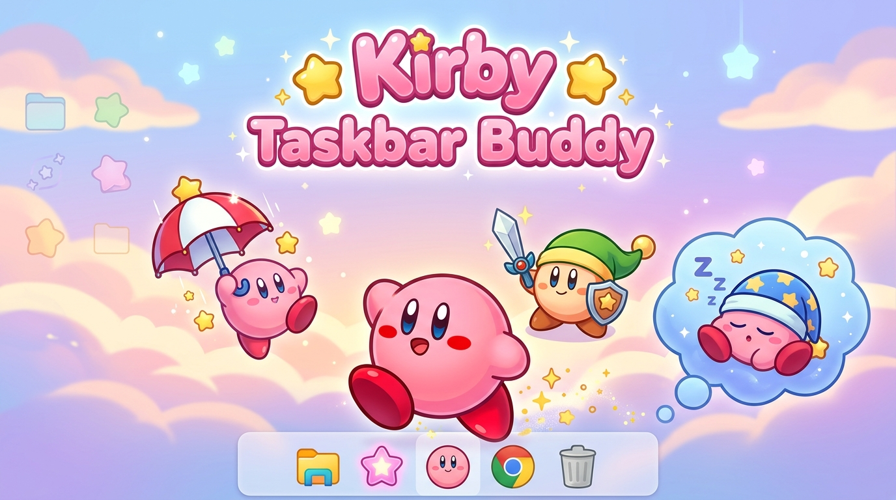</p>

<p align="center">
  <strong>A lightweight, portable desktop companion that strolls along your Windows taskbar.</strong><br>
  <em>Reacts to your typing with copy abilities, dodges your cursor, and leaps when you press space.</em>
</p>

<p align="center">
  
  
  
</p>

---

##  What is Kirby Taskbar Buddy?

Kirby Taskbar Buddy is a desktop companion application built for Windows. Kirby hangs out right above your taskbar on your primary monitor, keeping you company as you work, study, or game.

- **Transparent and Click-Through:** Built using a hardware-accelerated layered overlay (`WS_EX_TRANSPARENT`). Kirby never steals window focus, interrupts your typing, or blocks taskbar clicks.
- **Fullscreen Auto-Hide:** Automatically hides whenever you play games, watch fullscreen media, or enter presentations so he never gets in your way.
- **Completely Standalone:** All sprite assets are embedded directly into a single `.exe` binary. No installer, extra dependencies, or archive extractions needed.

---

## 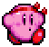 Features

### 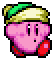 Reactive Copy Abilities
As you type in any application (web browser, text editor, terminal, or chat), Kirby reacts to matching keys by dynamically transforming into one of **19 classic copy abilities**. Pressing the same ability key again returns him to Normal Kirby.

### 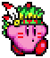 Spacebar Jump
Tapping <kbd>Space</kbd> anywhere on your system launches Kirby into the air with authentic gravity and somersault physics.

### 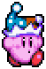 Cursor Danger Guard
Move your mouse cursor close to Kirby while he is on the taskbar, and he will immediately raise a defensive shield. Mirror Kirby even summons a shimmering hexagonal barrier.

<p align="center">
  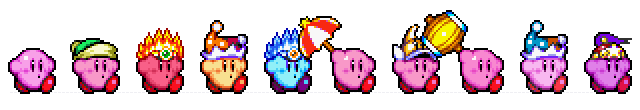
</p>

---

## 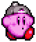 Copy Ability Cheat Sheet

Press any of the following keys anywhere on your system to transform Kirby:

<div align="center">

| Icon | Ability | Key | Icon | Ability | Key |
| :---: | :--- | :---: | :---: | :--- | :---: |
|  | Normal | <kbd>0</kbd> |  | Mirror | <kbd>m</kbd> |
| 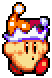 | Beam | <kbd>e</kbd> | 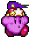 | Ninja | <kbd>n</kbd> |
| 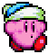 | Bomb | <kbd>b</kbd> |  | Paint | <kbd>p</kbd> |
| 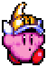 | Cutter | <kbd>c</kbd> | 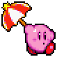 | Parasol | <kbd>r</kbd> |
|  | Fighter | <kbd>f</kbd> | 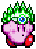 | Plasma | <kbd>a</kbd> |
| 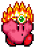 | Fire | <kbd>d</kbd> | 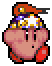 | Stone | <kbd>s</kbd> |
| 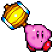 | Hammer | <kbd>h</kbd> | 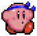 | Suplex | <kbd>u</kbd> |
| 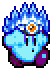 | Ice | <kbd>l</kbd> |  | Sword | <kbd>w</kbd> |
| 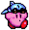 | Jet | <kbd>j</kbd> |  | Wheel | <kbd>v</kbd> |
|  | Wing | <kbd>g</kbd> | 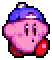 | Yo-Yo | <kbd>y</kbd> |

</div>

<p align="center">
  <em>Press <kbd>Space</kbd> anywhere to make Kirby jump.</em>
</p>

---

##  System Tray Controls

Right-click the Kirby icon in your Windows system tray (near the clock) to access settings:

- **Kirby Size:** Switch between **2x (Default)**, **3x (Large)**, and **4x (Extra Large)** pixel-perfect scaling.
- **Show Foreground Taskbar Kirby:** Toggle Kirby's visibility on or off.
- **Pause Key Switching:** Keep Kirby walking without changing abilities as you type.
- **Start with Windows:** Configure Kirby to start automatically when logging into Windows.
- **Exit:** Gracefully closes the application.

---

##  Privacy and Security Guarantee

Because Kirby reacts to your keystrokes, the application registers a low-level Windows keyboard hook (`WH_KEYBOARD_LL`).

- **100% Local and Offline:** The application contains no networking code, sockets, or HTTP requests. It cannot connect to the internet.
- **No Keystroke Logging:** Keys are matched in-memory solely to switch animation states. No keystrokes are ever saved to disk, logged, or cached.
- **Standard User Permissions:** Runs entirely in unprivileged user space without requiring administrator rights.

---

##  Installation

1. Go to the [Releases](https://github.com/Mumb0/kirby-taskbar-buddy/releases) page on GitHub.
2. Download `KirbyTaskbarBuddy.exe`.
3. Move the executable to any folder of your choice and double-click to run.

---

##  Building from Source

To compile the standalone executable from source using Windows' built-in .NET C# compiler:

```cmd
git clone https://github.com/Mumb0/kirby-taskbar-buddy.git
cd kirby-taskbar-buddy
build.bat
```

The `build.bat` script automatically bundles all sprite resources into `KirbyTaskbarBuddy.exe`.

---

##  Disclaimer and Credits

- Kirby and related character designs are trademarks of Nintendo and HAL Laboratory, Inc.
- This is an unofficial, non-commercial fan-made desktop project.
